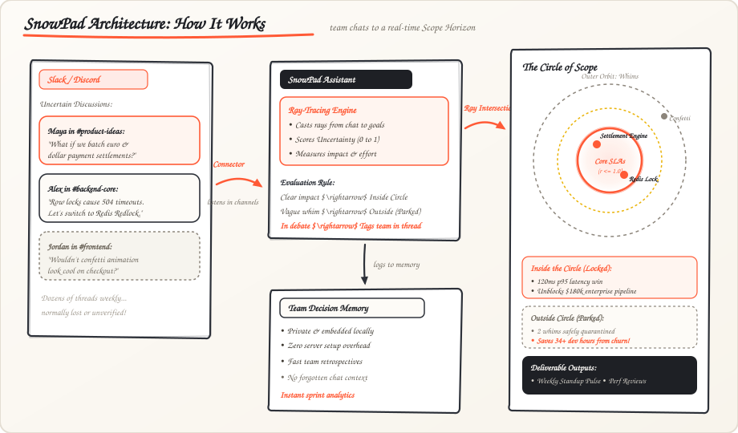

# ❄️ SnowPad

<p align="center">
  <b>The Chat Uncertainty &amp; Scope Radar for Engineering and Product Teams</b><br>
  <i>Autonomous Scope Radar &amp; Decision Memory • Built for the Flip the Switch Hackathon</i>
</p>

---

<p align="center">
  
</p>

<p align="center">
  👉 <b><a href="snowpad/web/radar.html">Interactive Scope Radar</a></b> • 
  <b><a href="snowpad/web/flow.html">Feature Lifecycle Flow</a></b> • 
  <b><a href="dist/team_q4_2026_wrapped.html">Quarterly Wrapped 🎁</a></b>
</p>

---

## 🎯 How Ray Tracing Works in SnowPad

In computer graphics, ray tracing calculates how light travels through a scene—testing whether a ray intersects with a solid surface, casts a shadow, or dissipates into the dark.

SnowPad applies this exact mathematical principle to team communications in Slack and Discord:

1. **The Focal Point (Origin):** The center of the radar represents your team's core commitments: response time SLAs, uptime, and active sprint deliverables.
2. **Casting the Ray:** Whenever team members discuss an ad-hoc idea, a proposed feature, or a quick architectural pivot in chat, SnowPad casts an analytical ray from that conversation toward the focal point.
3. **Intersection vs. Scatter:**
   * 🟢 **Intersection (Inside the Circle):** If the ray hits a verified KPI (such as reducing p95 latency or unblocking an enterprise customer) with high clarity, it penetrates the perimeter and lands inside the circle.
   * 🔴 **Scatter &amp; Shadow (Outside the Circle):** If the proposal is vague, lacks ownership, or has no measurable impact on active goals, the ray scatters into the outer shadow—quarantined as a parked whim so it does not derail developer focus.
4. **Visual Ray Sweep:** The radar HUD uses an active radial ray-marcher sweeping 360 degrees across all active channels, rendering the distance and uncertainty of every conversation in real time.

---

## 💬 The Problem: Loose Chats &amp; Scope Drift

Every day in team chat, dozens of micro-decisions unfold in threads:
* 💡 **Spontaneous feature suggestions:** *"What if we also added bulk CSV export to this screen?"*
* ⚙️ **Casual architectural tweaks:** *"Maybe we should just bypass the auth check with raw Redis keys for now?"*
* 🎨 **Well-intentioned whims:** *"Thinking of redesigning the admin drawer with confetti animations this afternoon."*

Because these conversations happen casually in chat:
1. **Uncertainty is never measured:** Developers often begin building things based on an offhand remark in a Tuesday thread, without anyone confirming whether it is actually a priority.
2. **Whims masquerade as urgent work:** Fleeting ideas pull engineers away from critical stability and performance work.
3. **Context vanishes:** When quarterly reviews arrive, there is no shared ledger showing why decisions were made or which distractions were avoided.

---

## ⭕ The Solution: The Circle of Scope

SnowPad listens to incoming conversations across your team's channels, evaluates the ambiguity of each proposal in real time, and maps it onto your team's **Circle of Scope**:

| Zone | Radial Distance | Meaning | Real Team Example |
| :--- | :---: | :--- | :--- |
| 🟢 **Inside the Circle** | $r \le 1.0$ | **Confirmed Features &amp; Core SLAs**<br>High certainty, locked into sprint, moving latency or revenue. | *"Batched Settlement Engine cuts p95 API latency by 120ms (Sprint-42)."* |
| 🟡 **Borderline Debate** | $0.6 \le r \le 1.0$ | **Active Chat Debates**<br>High uncertainty ($>50\%$), requiring technical lead or PM sign-off. | *"SQS vs Kafka audit logs: $1,400/mo AWS saving vs 2-week migration risk."* |
| 🔴 **Outside the Circle** | $r > 1.0$ | **Parked Whims**<br>Safely quarantined outside the circle to protect developer focus. | *"Lottie confetti animation on checkout (+140kb bundle bloat, zero lift)."* |

---

## 🚀 Key Capabilities

* 🎯 **Circle of Scope Radar:** Real-time visual HUD animating chat proposals as radar blips, scored by uncertainty percentage and scope distance.
* 🔀 **Feature Lifecycle Flowcharts & Traceability:** Full visibility into where each feature sparks in chat, how its uncertainty is audited, its scope horizon, and its final sprint SLA impact.
* 🎁 **Wholesome Quarterly Spotify-Wrapped:** Celebrates quarterly developer velocity with custom archetypes (*The Laser Architect*, *The Sprint Guardian*), dodged bullets, crown jewels, hours guarded, and shareable dossier cards.
* 👥 **Member &amp; Designation Sync:** Plugs directly into Discord and Slack to map team member designations and organizational hierarchy.
* 🛡️ **The Developer Sprint Shield:** Tracks how many off-scope whims were successfully quarantined, giving developers concrete proof of their focus during performance reviews:
  > *"Alex didn't just ship 2 critical features; SnowPad records that Alex also contained 3 off-scope whim requests, protecting 34 hours of sprint focus."*
* 🎭 **Live Sandbox Replay Simulator:** Built-in interactive Discord sandbox to test or record product demos with zero setup or external servers.
* 📊 **One-Click Executive Slide Decks:** Generates sleek Reveal.js executive presentations highlighting team velocity and SLA achievements.
* 📝 **Automated Sprint PRDs:** Automatically drafts refactor specifications from active team debates for immediate sprint planning.
* 🧠 **Zero-Config Decision Memory:** Fast, local embedded ledger that runs anywhere out of the box with zero external database configuration.

---

## ⚡ Quickstart

### 1. Installation

```bash
git clone https://github.com/Viswesh934/SnowPad.git
cd SnowPad

# Set up virtual environment and install dependencies
uv venv
uv pip install -e ".[dev]"
```

### 2. Initialize Workspace Memory

```bash
python -m snowpad.cli seed
```

### 3. Run the Live Demo Simulator

Watch simulated team discussions stream across channels and live-audit scope:

```bash
python -m snowpad.cli demo
```

*(Open `snowpad/web/radar.html` in your browser side-by-side to watch live radar blips appear during the replay!)*

### 4. Trace Feature Lifecycle Flowcharts

See where features began in chat, how they were audited, and where they landed:

```bash
# Terminal lifecycle flow tree
python -m snowpad.cli flow

# Interactive web pipeline visualizer
start snowpad/web/flow.html
```

### 5. Open the Scope Radar

```bash
# Terminal table view
python -m snowpad.cli radar

# Interactive Web HUD
start snowpad/web/radar.html
```

### 6. Experience SnowPad Wrapped (Spotify Wrapped for the Quarter) 🎁

```bash
# Contributor Spotify Wrapped story
python -m snowpad.cli wrapped --actor maya_patel

# Collective Team Wrapped story
python -m snowpad.cli wrapped
start dist/team_q4_2026_wrapped.html
```

### 7. Review Channel Chatter &amp; Weekly Pulse

```bash
# View breakdown of uncertainty across channels
python -m snowpad.cli chatter

# View the weekly operational pulse across all contributors
python -m snowpad.cli weekly
```

### 8. Generate Contributor Reviews &amp; Executive Presentations

```bash
# Terminal review dossier
python -m snowpad.cli review --actor maya_patel --quarter Q4-2026

# Export Reveal.js executive slide deck
python -m snowpad.cli export --actor maya_patel

# Export auto-generated Sprint Refactor PRD
python -m snowpad.cli export --prd
```

---

## 📜 License

Apache-2.0 / MIT • Built for the **Flip the Switch Hackathon 2026**
